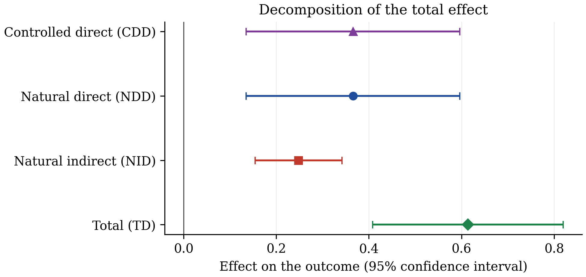
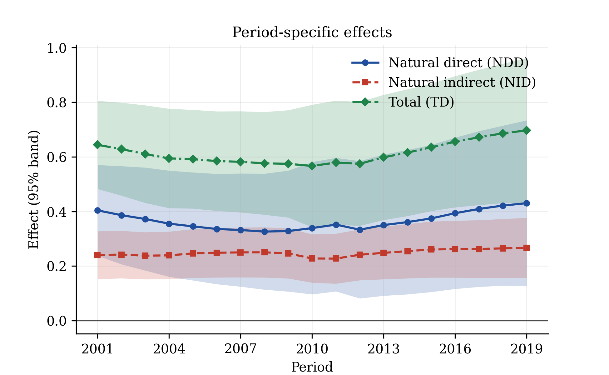
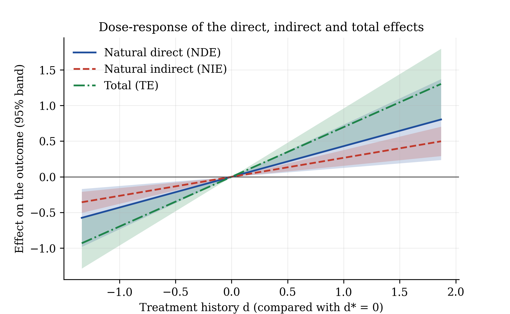
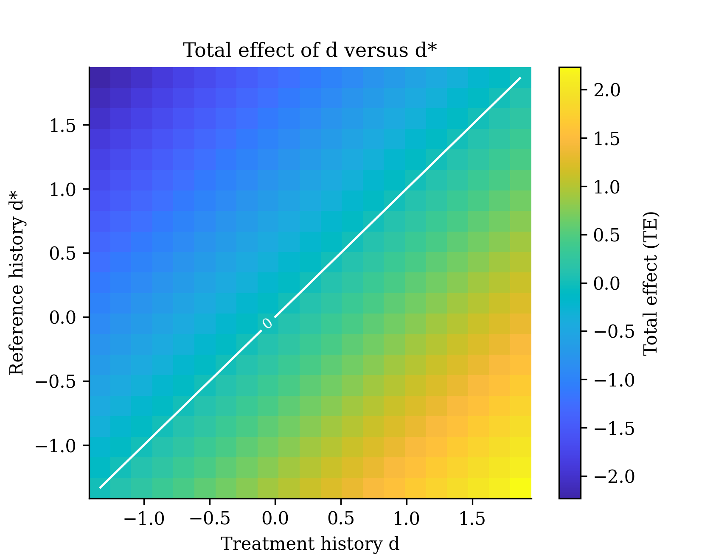
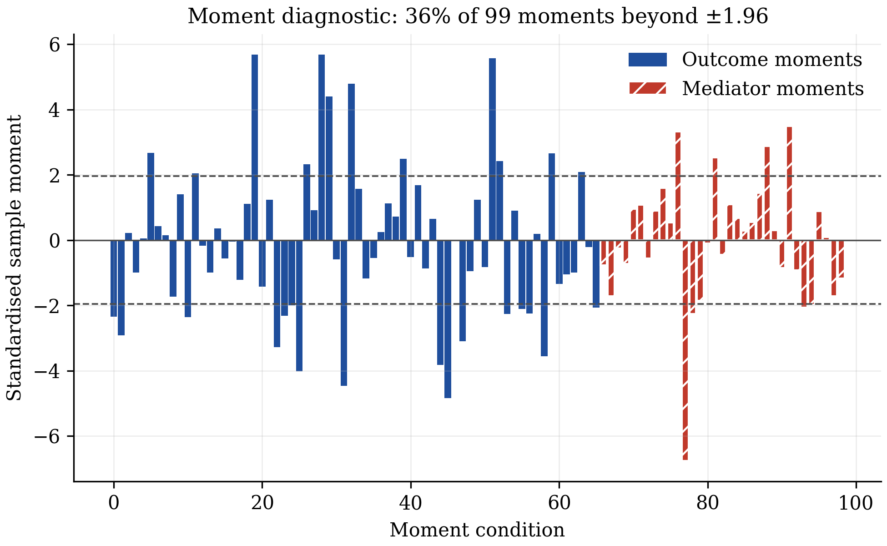

# panelmed

[](https://pypi.org/project/panelmed/)
[](https://pypi.org/project/panelmed/)
[](https://github.com/merwanroudane/panelmed/blob/main/LICENSE)
[](https://merwanroudane.github.io/panelmed/)

**panelmed** implements the double/debiased machine learning estimator for causal
mediation analysis in panel data of Wu and Xiao (2026),
[arXiv:2610.21339](https://doi.org/10.48550/arXiv.2610.21339), in Python. You give it
a panel with an outcome, a mediator, a treatment and covariates; it returns the
direct, indirect and total effects of the treatment with standard errors, tables
ready for a manuscript, and figures.

- Documentation: https://merwanroudane.github.io/panelmed/
- PyPI: https://pypi.org/project/panelmed/
- Author: Dr Merwan Roudane · merwanroudane920@gmail.com · https://github.com/merwanroudane

---

## Table of contents
1. [What this package does](#1-what-this-package-does)
2. [Start from absolutely nothing](#2-start-from-absolutely-nothing)
3. [Installation](#3-installation)
4. [Your first analysis in 60 seconds](#4-your-first-analysis-in-60-seconds)
5. [Complete example with real data](#5-complete-example-with-real-data)
6. [Full syntax reference](#6-full-syntax-reference)
7. [Interpreting the output](#7-interpreting-the-output)
8. [Using your own Excel or CSV file](#8-using-your-own-excel-or-csv-file)
9. [Exporting tables and figures](#9-exporting-tables-and-figures)
10. [The method](#10-the-method)
11. [Practical guidance and pitfalls](#11-practical-guidance-and-pitfalls)
12. [Limitations](#12-limitations)
13. [References](#13-references)
14. [Citation](#14-citation)
15. [Author and licence](#15-author-and-licence)

---

## 1. What this package does

Many questions ask not only *whether* a treatment changes an outcome but *through
which channel*. Employment raises local income: how much of that goes through wages?
Mediation analysis splits the **total effect** into a **direct effect** and an
**indirect effect** that passes through a mediator. With panel data the difficulty is
that unobserved, time-invariant characteristics of each unit can drive treatment,
mediator and outcome at once, and that observed confounders may act nonlinearly.

The estimator of Wu and Xiao (2026) handles both. It allows unit and period fixed
effects in all three equations, lets unknown nonlinear functions of the covariates
absorb observed confounding, and uses cross-fitting so that the machine-learning
step does not bias the estimates.

What you get:

- **Estimator**: DML-GMM for the outcome and mediator equations (Algorithm 1 of the paper).
- **Effects**: controlled direct, natural direct, natural indirect and total effects,
  as level contrasts between two treatment histories and as derivatives.
- **Inference**: analytical standard errors from influence functions, joint Wald
  tests, and a cross-sectional bootstrap that repeats the whole procedure.
- **Comparisons**: the naive benchmark of the paper, and a paired test of whether two
  specifications give different decompositions.
- **Beyond the paper**: two-step GMM with the Hansen J test, an analytical standard
  error for the mediated share, and a moment-diagnostic figure.
- **Output**: text, LaTeX, Markdown and HTML tables; six figure types.
- **Data**: the U.S. county panel used in the paper's application, and the paper's
  Monte Carlo generator.

## 2. Start from absolutely nothing

*If you have never used Python, do these four steps once. Fifteen minutes.*

### Step 1 - install Python
Download **Anaconda** (recommended for researchers: it includes Python, Jupyter and
Spyder in one installer) from https://www.anaconda.com/download, or plain Python from
https://www.python.org/downloads/. On the python.org installer, **tick "Add Python to
PATH"** on the first screen.

### Step 2 - open a terminal
- **Windows:** press `Win`, type `Anaconda Prompt` (or `cmd`), press Enter.
- **macOS:** press `Cmd+Space`, type `Terminal`, press Enter.

Check it works. Type this and press Enter:
```bash
python --version
```
You should see something like `Python 3.11.5`.

### Step 3 - install this package
```bash
pip install panelmed
```

### Step 4 - run your first command
Type `python`, press Enter, then paste:
```python
import panelmed
print(panelmed.__version__)
```
Type `exit()` to leave.

### Where do I write my code?
Any of these; pick one and stay with it.

| Tool | Best for | How to open |
|---|---|---|
| **Jupyter Notebook** | step-by-step work with figures inline | type `jupyter notebook` in the terminal |
| **Spyder** | a MATLAB/RStudio-like window | type `spyder`, or open it from Anaconda Navigator |
| **A `.py` file** | a reproducible script | save `analysis.py`, then run `python analysis.py` |

## 3. Installation

```bash
pip install panelmed
```
With interactive 3-D surfaces:
```bash
pip install "panelmed[plotly]"
```
Development version:
```bash
pip install git+https://github.com/merwanroudane/panelmed.git
```
Requirements: Python >= 3.10, numpy, scipy, pandas, matplotlib, scikit-learn, joblib
(installed automatically).

## 4. Your first analysis in 60 seconds

```python
from panelmed import PanelMediation, simulate_panel

# a simulated panel with known true effects: 1,600 units, 10 periods
df = simulate_panel(n=1600, t=10, seed=2026, as_frame=True)

model = PanelMediation(
    "y", "m", "d", ["x1", "x2", "x3", "x4", "x5"],      # outcome, mediator, treatment, covariates
    data=df, unit="unit", time="time",
    outcome=["d", "d**2", "L1_d", "d*x3", "m", "L1_m"],  # what enters the outcome equation
    mediator=["d", "d**2", "L1_d"],                      # what enters the mediator equation
)
res = model.fit(n_folds=10, seed=2026)
print(res.effects(d=1, d_star=0).summary())
```

```
======================================================================================
                  Panel mediation, level effects  (Wu & Xiao (2026))
======================================================================================
Outcome            : y                                 Units (N)        :         1600
Mediator           : m                                 Periods (T)      :           10
Treatment          : d                                 Folds (K)        :           10
Covariates         : 5                                 Instrument lags  :            2
Basis              : polynomial deg. 3 (55 terms)      Moments          :           83
Estimator          : DML-GMM                           Weighting        :     identity
--------------------------------------------------------------------------------------
Estimand        Coef.  Std.Err.        z   P>|z|      [95% Conf. Int.]
--------------------------------------------------------------------------------------
Effects
CDE            4.5065    0.0737   61.184   0.000     4.3621     4.6508 ***
NDE            4.5065    0.0737   61.184   0.000     4.3621     4.6508 ***
NIE            2.7899    0.0942   29.630   0.000     2.6053     2.9744 ***
TE             7.2964    0.1072   68.033   0.000     7.0862     7.5066 ***
--------------------------------------------------------------------------------------
Mediated share
NIE/TE         0.3824    0.0095                      0.3637     0.4010
======================================================================================
Significance: *** p<0.01, ** p<0.05, * p<0.10
Standard errors: estimated influence functions (Eq. 21, Theorem 3).
Treatment history d versus d*; mediator fixed at m for the CDE.
Total = natural direct + natural indirect. No test against zero is reported for the mediated share.
```

The true values in this simulated design are CDE = NDE = 4.5, NIE = 3 and TE = 7.5.

## 5. Complete example with real data

The package ships the panel used in the empirical application of Wu and Xiao (2026,
Section 6): **3,058 U.S. counties observed every year from 2000 to 2019**, assembled
by Cerqua, Letta and Pinto (2026). The question: when the workplace employment rate
of a county rises, personal income per capita rises too. How much of that goes
through the average wage?

| Role | Variable | Definition |
|---|---|---|
| Outcome `y` | log personal income per capita | USD, in logs |
| Mediator `m` | log average wage per job | USD, in logs |
| Treatment `d` | workplace employment rate | jobs located in the county per resident aged 18-65 |
| Covariates | 8 county characteristics, measured the year before | log population, share of income from unemployment insurance, population shares under 18 and over 65, births, deaths, net international and net domestic migration per 1,000 residents |

`load_us_counties()` returns the panel prepared as in the paper: years 2001-2019
(the year 2000 only supplies the lagged covariates), every variable winsorised at its
1% and 99% quantiles and standardised. Effects are therefore in standard deviations
of the outcome per standard deviation of the treatment.

The whole example is the script
[`examples/panelmed_empirical.py`](https://github.com/merwanroudane/panelmed/blob/main/examples/panelmed_empirical.py); the output below
is copied from a run of that script.

### Step 1 - load the data

```python
from panelmed import PanelMediation, compare_effects, load_us_counties
from panelmed.datasets import US_COUNTIES_COVARIATES as X

df = load_us_counties()
print(df.head(3).round(3).to_string(index=False))
```
```
 county_id        county_name  year      y      m      d  log_pop  ui_share  share_under18  share_over65  births  deaths  mig_international  mig_domestic
      1001 Autauga County, AL  2001 -1.054 -1.189 -0.929    0.297    -0.769          1.507        -1.392  -2.104  -2.174             -0.581         0.353
      1001 Autauga County, AL  2002 -0.991 -1.079 -1.036    0.310    -0.636          1.425        -1.368   0.798  -0.457             -0.568         0.714
      1001 Autauga County, AL  2003 -0.795 -1.029 -1.013    0.326    -0.450          1.473        -1.346   0.471  -0.427             -0.960         1.156

Counties: 3058, years: 2001-2019
```

### Step 2 - Specification I: the same effect in every county

```python
common = dict(data=df, unit="county_id", time="year", basis_degree=3, basis_max_vars=2)

spec1 = PanelMediation("y", "m", "d", X, outcome=["d", "m"], mediator=["d"], **common)
res1 = spec1.fit(n_folds=5, max_lags=2, seed=2026)
print(res1.summary())
```
```
======================================================================================
              Panel mediation, structural parameters  (Wu & Xiao (2026))
======================================================================================
Outcome            : y                                 Units (N)        :         3058
Mediator           : m                                 Periods (T)      :           19
Treatment          : d                                 Folds (K)        :            5
Covariates         : 8                                 Instrument lags  :            2
Basis              : polynomial deg. 3 (108 terms)     Moments          :           99
Estimator          : DML-GMM                           Weighting        :     identity
--------------------------------------------------------------------------------------
Parameter       Coef.  Std.Err.        z   P>|z|      [95% Conf. Int.]
--------------------------------------------------------------------------------------
Outcome equation (theta)
theta[d]       0.2089    0.0875    2.388   0.017     0.0375     0.3803 **
theta[m]       0.6593    0.0943    6.991   0.000     0.4744     0.8441 ***
--------------------------------------------------------------------------------------
Mediator equation (gamma)
gamma[d]       0.6063    0.0780    7.775   0.000     0.4535     0.7592 ***
======================================================================================
Significance: *** p<0.01, ** p<0.05, * p<0.10
Sandwich standard errors from the stacked individual scores (Eq. A.15); N -> infinity, T fixed.
Moments: 66 outcome + 33 mediator; Jacobian condition number 2.0.
```

### Step 3 - Specification II: effects that vary with county characteristics

```python
inter = [f"d*{c}" for c in X]          # d*log_pop, d*ui_share, ...
spec2 = PanelMediation("y", "m", "d", X, outcome=["d", "m"] + inter,
                       mediator=["d"] + inter, **common)
res2 = spec2.fit(n_folds=5, max_lags=2, seed=2026)
print(res2.summary())
```
```
==================================================================================================
                    Panel mediation, structural parameters  (Wu & Xiao (2026))
==================================================================================================
Outcome            : y                                             Units (N)        :         3058
Mediator           : m                                             Periods (T)      :           19
Treatment          : d                                             Folds (K)        :            5
Covariates         : 8                                             Instrument lags  :            2
Basis              : polynomial deg. 3 (108 terms)                 Moments          :          627
Estimator          : DML-GMM                                       Weighting        :     identity
--------------------------------------------------------------------------------------------------
Parameter                       Coef.  Std.Err.        z   P>|z|      [95% Conf. Int.]
--------------------------------------------------------------------------------------------------
Outcome equation (theta)
theta[d]                       0.3657    0.1176    3.109   0.002     0.1352     0.5962 ***
theta[m]                       0.5264    0.1110    4.743   0.000     0.3088     0.7439 ***
theta[d*log_pop]              -0.0058    0.0613   -0.095   0.924    -0.1259     0.1142
theta[d*ui_share]              0.0045    0.0102    0.439   0.661    -0.0155     0.0245
theta[d*share_under18]         0.1907    0.0748    2.550   0.011     0.0441     0.3373 **
theta[d*share_over65]          0.2314    0.0648    3.571   0.000     0.1044     0.3583 ***
theta[d*births]               -0.0206    0.0110   -1.873   0.061    -0.0421     0.0010 *
theta[d*deaths]                0.0089    0.0132    0.669   0.503    -0.0171     0.0348
theta[d*mig_international]     0.0344    0.0116    2.966   0.003     0.0117     0.0572 ***
theta[d*mig_domestic]         -0.0055    0.0079   -0.698   0.485    -0.0210     0.0100
--------------------------------------------------------------------------------------------------
Mediator equation (gamma)
gamma[d]                       0.4715    0.0905    5.210   0.000     0.2942     0.6489 ***
gamma[d*log_pop]              -0.0247    0.0560   -0.440   0.660    -0.1345     0.0851
gamma[d*ui_share]             -0.0217    0.0074   -2.923   0.003    -0.0362    -0.0071 ***
gamma[d*share_under18]        -0.0331    0.0279   -1.189   0.234    -0.0877     0.0215
gamma[d*share_over65]         -0.0038    0.0346   -0.109   0.913    -0.0715     0.0640
gamma[d*births]               -0.0083    0.0067   -1.232   0.218    -0.0214     0.0049
gamma[d*deaths]                0.0125    0.0092    1.359   0.174    -0.0055     0.0306
gamma[d*mig_international]     0.0006    0.0062    0.102   0.919    -0.0115     0.0127
gamma[d*mig_domestic]         -0.0012    0.0054   -0.222   0.824    -0.0118     0.0094
==================================================================================================
Significance: *** p<0.01, ** p<0.05, * p<0.10
Sandwich standard errors from the stacked individual scores (Eq. A.15); N -> infinity, T fixed.
Moments: 330 outcome + 297 mediator; Jacobian condition number 23.6.
```

### Step 4 - direct, indirect and total effects, averaged over 2001-2019

```python
eff1 = res1.derivatives(d=0, period="average")
eff2 = res2.derivatives(d=0, period="average")
print(eff1.summary())
print(eff2.summary())
```
```
======================================================================================
               Panel mediation, derivative effects  (Wu & Xiao (2026))
======================================================================================
Outcome            : y                                 Units (N)        :         3058
Mediator           : m                                 Periods (T)      :           19
Treatment          : d                                 Folds (K)        :            5
Covariates         : 8                                 Instrument lags  :            2
Basis              : polynomial deg. 3 (108 terms)     Moments          :           99
Estimator          : DML-GMM                           Weighting        :     identity
--------------------------------------------------------------------------------------
Estimand        Coef.  Std.Err.        z   P>|z|      [95% Conf. Int.]
--------------------------------------------------------------------------------------
Effects
CDD            0.2089    0.0875    2.388   0.017     0.0375     0.3803 **
NDD            0.2089    0.0875    2.388   0.017     0.0375     0.3803 **
NID            0.3997    0.0703    5.689   0.000     0.2620     0.5375 ***
TD             0.6086    0.0786    7.746   0.000     0.4546     0.7626 ***
--------------------------------------------------------------------------------------
Mediated share
NID/TD         0.6568    0.1199                      0.4218     0.8918
======================================================================================
Significance: *** p<0.01, ** p<0.05, * p<0.10
Standard errors: estimated influence functions (Eq. 21, Theorem 3).
Derivative with respect to the treatment of the effect's own period.
Total = natural direct + natural indirect. No test against zero is reported for the mediated share.
```
```
======================================================================================
               Panel mediation, derivative effects  (Wu & Xiao (2026))
======================================================================================
Outcome            : y                                 Units (N)        :         3058
Mediator           : m                                 Periods (T)      :           19
Treatment          : d                                 Folds (K)        :            5
Covariates         : 8                                 Instrument lags  :            2
Basis              : polynomial deg. 3 (108 terms)     Moments          :          627
Estimator          : DML-GMM                           Weighting        :     identity
--------------------------------------------------------------------------------------
Estimand        Coef.  Std.Err.        z   P>|z|      [95% Conf. Int.]
--------------------------------------------------------------------------------------
Effects
CDD            0.3657    0.1177    3.107   0.002     0.1350     0.5964 ***
NDD            0.3657    0.1177    3.107   0.002     0.1350     0.5964 ***
NID            0.2482    0.0478    5.193   0.000     0.1545     0.3419 ***
TD             0.6139    0.1051    5.843   0.000     0.4080     0.8198 ***
--------------------------------------------------------------------------------------
Mediated share
NID/TD         0.4043    0.1068                      0.1949     0.6137
======================================================================================
Significance: *** p<0.01, ** p<0.05, * p<0.10
Standard errors: estimated influence functions (Eq. 21, Theorem 3).
Derivative with respect to the treatment of the effect's own period.
Total = natural direct + natural indirect. No test against zero is reported for the mediated share.
```

Compared with Table 2 of the paper:

| | NDD | NID | TD | NID/TD |
|---|---:|---:|---:|---:|
| Specification I, paper | 0.2145 | 0.4017 | 0.6162 | 0.6519 |
| Specification I, panelmed | 0.2089 | 0.3997 | 0.6086 | 0.6568 |
| Specification II, paper | 0.3597 | 0.2502 | 0.6099 | 0.4103 |
| Specification II, panelmed | 0.3657 | 0.2482 | 0.6139 | 0.4043 |

The small differences come from the random fold split, which the paper does not
publish. The paper reports bootstrap standard errors (500 replications); the tables
above use the analytical ones. For bootstrap standard errors run
`python panelmed_empirical.py 200` (slow: every replication repeats the whole
procedure).

### Step 5 - does the decomposition change between the two specifications?

```python
print(compare_effects(eff1, eff2))
```
```
======================================================================================
         Paired difference between specifications (B - A)  (Wu & Xiao (2026))
======================================================================================
Outcome            : y                                 Units (N)        :         3058
Mediator           : m                                 Periods (T)      :           19
Treatment          : d                                 Folds (K)        :            5
Covariates         : 8                                 Instrument lags  :            2
Basis              : polynomial deg. 3 (108 terms)     Moments          :          627
Estimator          : DML-GMM                           Weighting        :     identity
--------------------------------------------------------------------------------------
Estimand        Coef.  Std.Err.        z   P>|z|      [95% Conf. Int.]
--------------------------------------------------------------------------------------
CDD            0.1568    0.0762    2.056   0.040     0.0074     0.3062 **
NDD            0.1568    0.0762    2.056   0.040     0.0074     0.3062 **
NID           -0.1515    0.0510   -2.972   0.003    -0.2515    -0.0516 ***
TD             0.0053    0.0698    0.075   0.940    -0.1315     0.1421
NID/TD        -0.2525    0.0813   -3.105   0.002    -0.4119    -0.0931 ***
======================================================================================
Significance: *** p<0.01, ** p<0.05, * p<0.10
Standard errors: difference of the unit-level influence functions.
```

The total effect is the same in both specifications, but the share going through
wages drops from about two thirds to about 40%. This is the paper's main empirical
message: a stable total effect does not validate its direct/indirect split.

### Step 6 - figures

```python
fig, ax = eff2.plot()
fig.savefig("decomposition.pdf")
res2.derivatives(d=0, period="all").plot_profile()
res2.plot_dose_response()
res2.plot_surface()
res1.plot_moments()
```



*Direct, indirect and total effect under Specification II, with 95% intervals.*



*Year-by-year effects under Specification II. All three profiles are mildly U-shaped,
as in Figure A.1 of the paper.*



*Effects of moving the employment rate from 0 (its mean) to each value `d`, in
standard deviations.*



*Total effect for every pair of treatment histories `(d, d*)`.*



*Standardised sample moments of Specification I at the estimate.*

## 6. Full syntax reference

### `PanelMediation(y, m, d, x=None, *, outcome, mediator, ...)`

Sets up the model of Eq. (4) of the paper.

| Argument | Type | Default | Meaning |
|---|---|---|---|
| `y`, `m`, `d` | column names, or `(N, T)` arrays | required | outcome, continuous mediator, treatment (binary, multivalued or continuous) |
| `x` | list of column names, or `(N, T, K)` array | `None` | time-varying covariates entering `f0`, `g0`, `h0` |
| `outcome` | list of str / callables | required | outcome dictionary `tau_Y` (Section 2.3) |
| `mediator` | list of str / callables | required | mediator dictionary `tau_M` (Section 2.3); cannot contain `m` |
| `data` | DataFrame | `None` | long-format balanced panel |
| `unit`, `time` | str | `None` | identifier columns, required with `data` |
| `x_names` | list of str | `x1, x2, ...` | covariate names for array input |
| `basis_degree` | int | `3` | degree of the polynomial library approximating the nuisance functions (App. D.1) |
| `basis_max_vars` | int or None | `None` | keep monomials with at most this many distinct covariates (App. E.1 uses 2) |
| `basis_lags` | int | `0` | covariate lags entering the library |
| `basis` | callable | `None` | custom library `X -> (N, T, p)` |
| `iv_interact` | `"auto"` or list of names | `"auto"` | covariates interacted with the lagged treatment residual in the instruments (App. D.1) |
| `iv_square` | `"auto"` or bool | `"auto"` | add the squared lagged treatment residual as an instrument (App. D.1) |

**How to write a dictionary.** Each term is a Python expression using `d` (treatment),
`m` (mediator), your covariate names, and the lag prefix `L1_`, `L2_`, ...

| You write | It means |
|---|---|
| `"d"` | current treatment |
| `"d**2"` | squared treatment |
| `"L1_d"` | treatment one period earlier |
| `"d*x3"` | treatment times covariate `x3` (effect varies with `x3`) |
| `"m"`, `"L1_m"` | current and lagged mediator (outcome dictionary only) |
| `"d*m"` | treatment-mediator interaction |

Do not include terms that depend on covariates only; the nuisance functions absorb
them.

### `model.fit(n_folds=5, max_lags=2, penalty="plugin", method="dml", weighting="identity", seed=None)`

| Argument | Type | Default | Meaning |
|---|---|---|---|
| `n_folds` | int >= 3 | `5` | number of folds `K` (Algorithm 1, step 1) |
| `max_lags` | int or None | `2` | residual dates kept in each instrument vector; `None` = full history (Section 3.1) |
| `penalty` | `"plugin"`, `"cv"` or float | `"plugin"` | first-stage l1 penalty; `"plugin"` is `sqrt(2 log(2p)/n)` (App. D.1) |
| `method` | `"dml"` or `"naive"` | `"dml"` | `"naive"` is the benchmark of Section 5.1 |
| `weighting` | `"identity"` or `"optimal"` | `"identity"` | one-step GMM as in the paper, or two-step with the J test |
| `seed` | int or None | `None` | seed of the random fold split; set it for reproducible results |

**Returns** a `PanelMediationResults` object.

### `PanelMediationResults`

| Attribute / method | Returns | Meaning |
|---|---|---|
| `.params`, `.bse`, `.zvalues`, `.pvalues` | Series | coefficients `theta` and `gamma` with sandwich standard errors (Eq. A.15) |
| `.cov` | DataFrame | covariance matrix of the coefficients |
| `.conf_int(level=0.95)` | DataFrame | Wald confidence intervals |
| `.n_moments`, `.jacobian_cond` | int, float | number of moment conditions; condition number of the moment Jacobian |
| `.j_stat`, `.j_df`, `.j_pvalue` | float | Hansen J test (two-step GMM only) |
| `.summary()` | printable table | coefficient table |
| `.to_frame()` / `.to_latex()` / `.to_markdown()` | DataFrame / str / str | export |
| `.effects(d=1, d_star=0, m=0, period="last", level=0.95, se="analytic")` | `EffectsResult` | CDE, NDE, NIE, TE (Definition 1) |
| `.derivatives(d=1, m=0, period="last", wrt=None, level=0.95, se="analytic")` | `EffectsResult` | CDD, NDD, NID, TD (Definition 2) |
| `.bootstrap(n_boot=199, seed=None, n_jobs=1)` | self | cross-sectional bootstrap of the whole procedure |
| `.plot_coefficients()`, `.plot_moments()`, `.plot_dose_response()`, `.plot_surface()` | `(fig, ax)` | figures |

Arguments of `effects` and `derivatives`:

| Argument | Meaning |
|---|---|
| `d`, `d_star` | the two treatment histories compared. A number means that value in every period; a list of length `T` gives a path; an `(N, T)` array gives unit-specific paths |
| `m` | mediator history held fixed for the controlled direct effect |
| `period` | `"last"`, a period number (1 = first), a list, `"all"` (one row per period) or `"average"` (mean over periods, Eq. 24) |
| `wrt` | for derivatives: the period whose treatment is varied; default is the effect's own period |
| `se` | `"analytic"` (Eq. 21) or `"bootstrap"` (run `.bootstrap()` first) |

### `EffectsResult`

| Attribute / method | Returns | Meaning |
|---|---|---|
| `.frame` | DataFrame | estimate, se, z, p, ci_low, ci_high, kind, period |
| `.cov`, `.influence` | DataFrame, array | joint covariance and influence functions (Theorem 2) |
| `.summary()`, `.to_latex()`, `.to_markdown()` | table / str | export |
| `.wald(rows, value=0)` | dict | joint Wald test; handles the singular covariance of effects that add up |
| `.plot()`, `.plot_profile()` | `(fig, ax)` | decomposition and period profile |

### Other functions

| Function | Meaning |
|---|---|
| `panelmed(y, m, d, x, outcome=..., mediator=..., ...)` | one call: builds the model and fits it |
| `compare_effects(a, b)` | paired difference `b - a` between two specifications on the same panel |
| `load_us_counties(prepared=True)` | the county panel of the paper's application |
| `simulate_panel(n, t, design, seed, as_frame)` | the paper's Monte Carlo panel |
| `parula_colors(n)`, `resolve_colorscale(name)` and the other colour helpers | colour maps used by the figures |

## 7. Interpreting the output

**The coefficient table** (`res.summary()`).
`theta[...]` are the coefficients of the outcome equation and `gamma[...]` those of the
mediator equation. `theta[m]` is the effect of the mediator on the outcome;
`gamma[d]` is the effect of the treatment on the mediator. Their product is the core
of the indirect effect. The last line reports the number of moment conditions and the
condition number of the moment Jacobian: a very large condition number (above about
1,000) signals weak identification.

**The effects table** (`res.effects(...).summary()`).

| Row | Reading |
|---|---|
| `CDE` | controlled direct effect: change in the outcome when the treatment history moves from `d_star` to `d` while the mediator is held at `m` for everyone |
| `NDE` | natural direct effect: the same change, but the mediator stays at the value it would have taken under `d_star` |
| `NIE` | natural indirect effect: the change caused only by the mediator moving from its value under `d_star` to its value under `d` |
| `TE` | total effect; always `NDE + NIE` |
| `NIE/TE` | share of the total effect transmitted by the mediator |

`CDE` and `NDE` coincide when the outcome dictionary has no treatment-mediator
interaction. The derivative table reads the same way for an infinitesimal increase in
one period's treatment (`CDD`, `NDD`, `NID`, `TD`).

**Stars** mark p-values below 0.01, 0.05 and 0.10 for the null of a zero effect.
**Standard errors** are valid as the number of units grows with the number of periods
fixed, and allow any serial dependence within a unit.

**Figures.**
- *Decomposition* (`eff.plot()`): one row per effect with its confidence interval.
- *Profile* (`eff.plot_profile()`): effect in each period with a confidence band. When
  the coefficients are constant, movements over time come from changes in the
  covariates that interact with the treatment.
- *Dose-response* (`res.plot_dose_response()`): direct, indirect and total effect of
  moving the treatment from `d*` to each value `d`.
- *Surface* (`res.plot_surface()`): an effect for every pair `(d, d*)`; the white line
  marks zero.
- *Moment diagnostic* (`res.plot_moments()`): each bar is a standardised sample moment.
  Many bars far outside the dashed lines suggest a misspecified dictionary or invalid
  instruments.

## 8. Using your own Excel or CSV file

Your file must be in **long format**: one row per unit and period, with a column
identifying the unit and a column identifying the period.

```python
import pandas as pd
from panelmed import PanelMediation

df = pd.read_excel("C:/Users/you/Documents/mydata.xlsx")   # or pd.read_csv("mydata.csv")
df = df.dropna(subset=["income", "wage", "employment", "pop", "age"])

model = PanelMediation(
    "income", "wage", "employment", ["pop", "age"],
    data=df, unit="county", time="year",
    outcome=["employment", "wage"], mediator=["employment"],
)
res = model.fit(seed=1)
print(res.summary())
print(res.effects(d=1, d_star=0).summary())
```

Notes:
- On Windows use forward slashes `C:/...` or double backslashes `C:\\...`.
- The panel must be **balanced**: every unit observed in every period, no missing values.
- Covariate column names must be plain identifiers (letters, digits, underscore) and
  cannot be `d` or `m`; rename with `df = df.rename(columns={"old name": "new_name"})`.
- Standardising the variables (`(x - x.mean()) / x.std()`) makes `d=1` versus
  `d_star=0` a one-standard-deviation change.

## 9. Exporting tables and figures

```python
print(res.to_latex())                           # paste into your manuscript
res.to_frame().to_excel("coefficients.xlsx")    # open in Excel or Word
eff = res.effects(d=1, d_star=0)
eff.to_frame().to_excel("effects.xlsx")

fig, ax = eff.plot()
fig.savefig("figure1.pdf")                      # vector, for the journal
fig.savefig("figure1.png", dpi=300)             # raster, for slides
```

The LaTeX output uses `booktabs` and the `\sym` command; add
`\newcommand{\sym}[1]{\ensuremath{^{#1}}}` to your preamble.

## 10. The method

The model for unit `i` and period `t` is

```
Y_it = tau_Y(D, M, X)' theta + f0(X) + alpha^Y_i + lambda^Y_t + eps^Y_it
M_it = tau_M(D, X)'   gamma + g0(X) + alpha^M_i + lambda^M_t + eps^M_it
```

where `tau_Y` and `tau_M` are your dictionaries, `f0` and `g0` are unknown functions
of the covariates, `alpha` are unit effects and `lambda` period effects.
Identification rests on sequential conditional independence given the observed history
and the unit effects (Assumption 4 of the paper), so any time-invariant confounder is
allowed.

Estimation, in the order of the code:

| Step | Paper | What happens |
|---|---|---|
| 1 | Eq. (7) | first differences remove the unit effects |
| 2 | Algorithm 1, steps 1-2 | units are split into `K` folds: one evaluates the score, the next supplies period means, the rest train the nuisance functions |
| 3 | App. D.1 | `f0`, `g0` and a preliminary `gamma` are fitted by l1-penalised IV; `h0` (treatment equation) by least squares |
| 4 | Eq. (8) | period effects are removed by subtracting the auxiliary-fold mean |
| 5 | Algorithm 1, step 3 | residuals `U^Y`, `U^M`, `U^D`; instruments are lagged treatment and mediator residuals |
| 6 | Eq. (12) | the two equations are stacked and solved by GMM in closed form |
| 7 | Eq. (A.15) | sandwich covariance of the coefficients |
| 8 | Eqs. (13)-(14) | counterfactual mediator and outcome for any treatment history |
| 9 | Eqs. (18)-(21) | effects as averages of unit contributions, with influence-function standard errors |

The full map from every function to its equation, and the choices made where the
paper's text leaves room, are in [docs/methods.md](https://github.com/merwanroudane/panelmed/blob/main/docs/methods.md).

**Check against the paper.** `examples/monte_carlo_table1.py` reruns the design of the
paper's Table 1 (N = 1600, T = 10). With 300 replications:

| Estimand | Mean | Bias | SD | ASE | Coverage | Paper: bias | Paper: SD | Paper: coverage |
|---|---:|---:|---:|---:|---:|---:|---:|---:|
| `theta[d]` | 1.9974 | -0.0026 | 0.0283 | 0.0280 | 0.947 | -0.0019 | 0.0274 | 0.951 |
| `theta[m]` | 0.9949 | -0.0051 | 0.0200 | 0.0205 | 0.957 | -0.0044 | 0.0204 | 0.958 |
| `gamma[d]` | 0.9917 | -0.0083 | 0.0342 | 0.0360 | 0.970 | -0.0093 | 0.0342 | 0.955 |
| NDE | 4.5041 | 0.0041 | 0.0746 | 0.0733 | 0.930 | 0.0015 | 0.0731 | 0.950 |
| NIE | 2.9726 | -0.0274 | 0.0985 | 0.1029 | 0.943 | -0.0274 | 0.0993 | 0.944 |
| TE | 7.4767 | -0.0233 | 0.1044 | 0.1104 | 0.977 | -0.0259 | 0.1053 | 0.947 |
| TD | 4.9912 | -0.0088 | 0.0732 | 0.0746 | 0.950 | -0.0113 | 0.0725 | 0.952 |

The naive benchmark fails in the same way as in the paper: `gamma[d]` has mean 0.7996
and coverage 0.000 (paper: 0.8230 and 0.000), and the total effect has coverage 0.003
(paper: 0.012). The paper uses 1,000 replications, so coverage differences of about
0.02 are within Monte Carlo error.

## 11. Practical guidance and pitfalls

- **Sample size.** The theory is for many units and few periods. Use at least a few
  hundred units; with fewer, reduce `n_folds` to 3-5 and keep the dictionaries small.
- **Periods.** You need `T >= 3`. Two periods are consumed by differencing and by the
  lagged instruments.
- **Folds.** `n_folds=5` is a sensible default; `10` uses more data for the nuisance
  functions when `N` is large. Results depend slightly on the random split, so always
  set `seed` and check that conclusions hold for a second seed.
- **Dictionaries.** Start simple (`["d", "m"]` and `["d"]`), then add lags, squares
  and interactions. The paper's application shows that the total effect can be stable
  while the direct/indirect split changes with the specification; report both.
- **Identification error.** If `fit` raises `IdentificationError`, the instruments
  cannot separate the coefficients: increase `max_lags`, simplify the dictionary, or
  check that the treatment varies within units over time.
- **Standardise.** Put variables on comparable scales before fitting; the polynomial
  library is numerically better behaved and effects are easier to read.
- **Bootstrap.** Each replication repeats the full procedure, so it is slow on large
  panels; use `n_jobs=-2` to run in parallel. Analytical standard errors are instant.
- **A common mistake**: putting the mediator in the mediator dictionary, or leaving
  it out of the outcome dictionary. The package stops with a clear message in both
  cases.

## 12. Limitations

- One scalar, continuous mediator. Vector mediators (Appendix A.1 of the paper) are
  not implemented.
- Balanced panels only, as in the paper.
- The nuisance functions are fitted by a penalised regression on a basis of the
  covariates; other machine-learning learners are not offered, because under
  sequential exogeneity the paper only specifies penalised IV/GMM first stages.
- The paper does not prove bootstrap consistency; it uses the bootstrap in its
  application, and so does this package.
- The causal interpretation requires Assumption 4 of the paper (sequential conditional
  independence given the unit effects). The package cannot test it.
- No public code of the original authors exists for this estimator. Agreement was
  checked against the paper's reported Monte Carlo and empirical tables, not against
  another implementation.

## 13. References

- Wu, P. and Xiao, Z. (2026). "Causal Mediation Analysis for Panel Data with
  Double/Debiased Machine Learning". arXiv:2610.21339.
  https://doi.org/10.48550/arXiv.2610.21339
- Wu, P. and Xiao, Z. (2026). "Double/Debiased Machine Learning for Treatment Effects
  in Dynamic Panels". *Journal of the American Statistical Association*.
  https://doi.org/10.1080/01621459.2026.2696607
- Chernozhukov, V., Chetverikov, D., Demirer, M., Duflo, E., Hansen, C., Newey, W. and
  Robins, J. (2018). "Double/debiased machine learning for treatment and structural
  parameters". *The Econometrics Journal*, 21(1), C1-C68.
  https://doi.org/10.1111/ectj.12097
- Kapetanios, G. (2008). "A bootstrap procedure for panel data sets with many
  cross-sectional units". *The Econometrics Journal*, 11(2), 377-395.
  https://doi.org/10.1111/j.1368-423X.2008.00243.x
- Hansen, L. P. (1982). "Large sample properties of generalized method of moments
  estimators". *Econometrica*, 50(4), 1029-1054. https://doi.org/10.2307/1912775
- Cerqua, A., Letta, M. and Pinto, G. (2026). "On the (mis)use of machine learning
  with panel data". *Oxford Bulletin of Economics and Statistics*, 88(3), 506-518.
  https://doi.org/10.1111/obes.70019

*(Every DOI above was checked on https://doi.org/.)*

## 14. Citation

```bibtex
@software{roudane_panelmed,
  author  = {Roudane, Merwan},
  title   = {{panelmed}: causal mediation analysis for panel data with double/debiased machine learning},
  year    = {2026},
  url     = {https://github.com/merwanroudane/panelmed},
  version = {0.1.1}
}
```
Please also cite the original paper: Wu, P. and Xiao, Z. (2026), "Causal Mediation
Analysis for Panel Data with Double/Debiased Machine Learning", arXiv:2610.21339,
https://doi.org/10.48550/arXiv.2610.21339.

## 15. Author and licence

**Dr Merwan Roudane**
merwanroudane920@gmail.com
https://github.com/merwanroudane

Released under the MIT Licence; see [LICENSE](https://github.com/merwanroudane/panelmed/blob/main/LICENSE).
